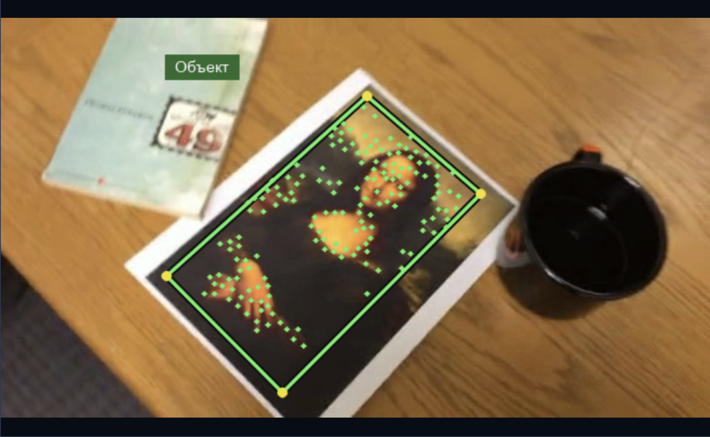
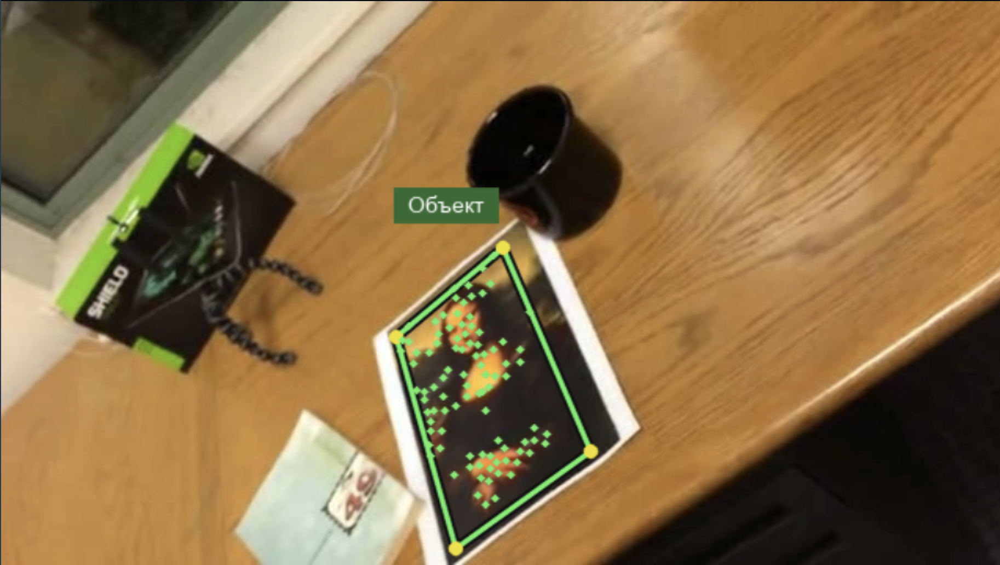
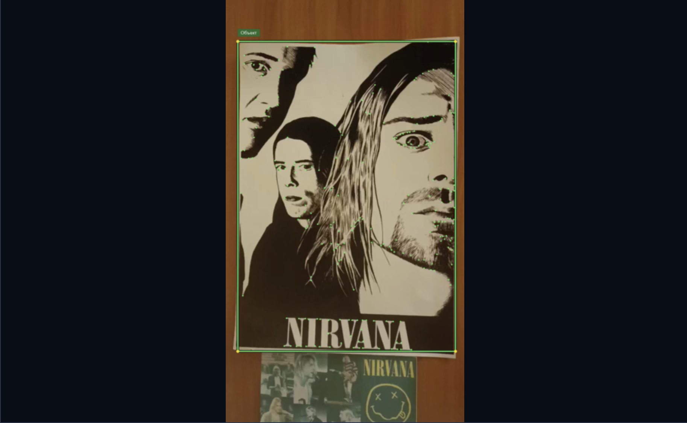
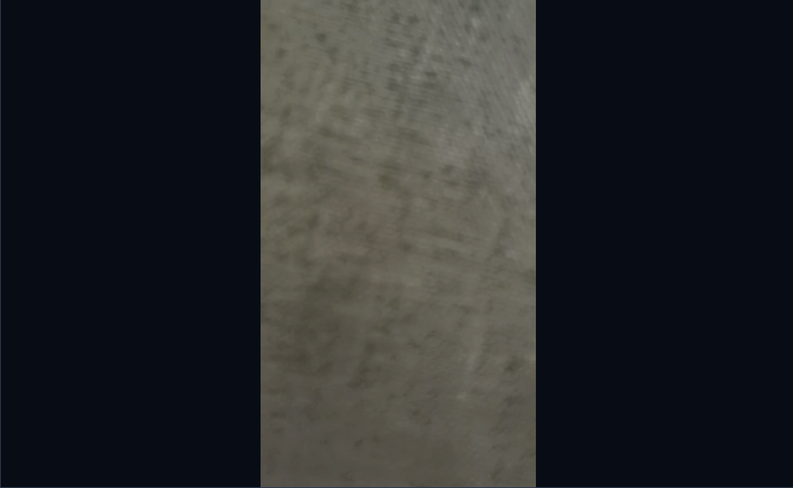
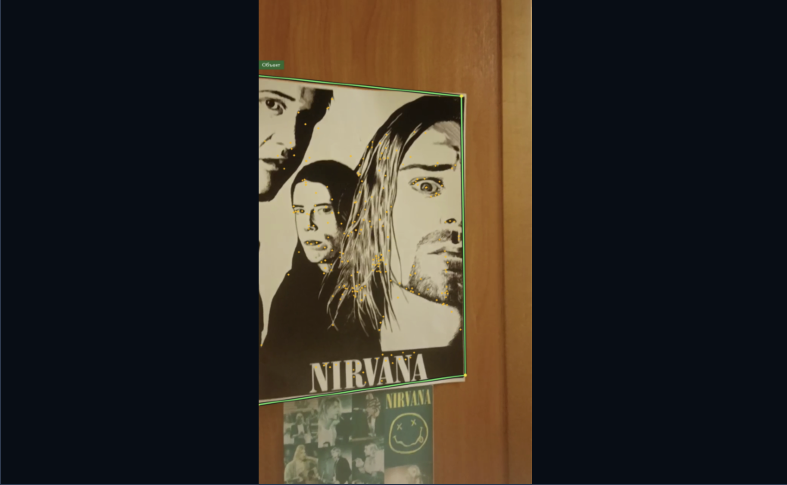
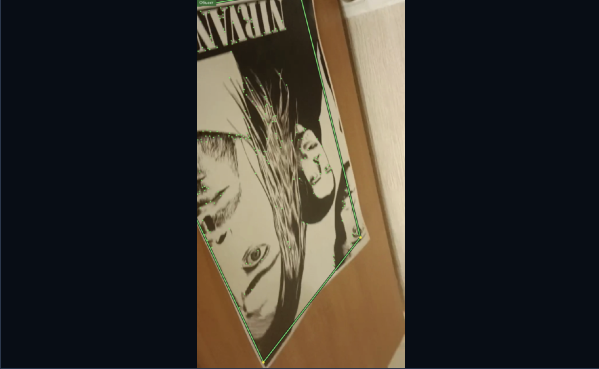
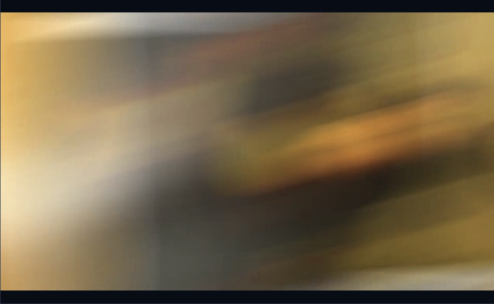
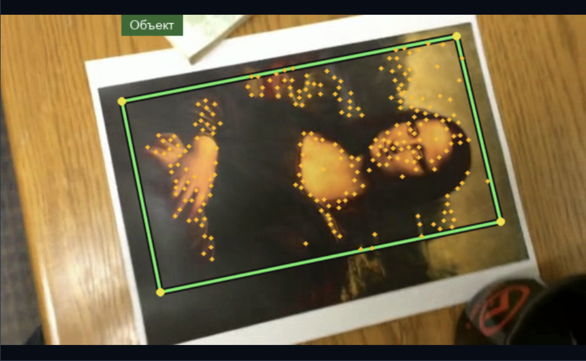
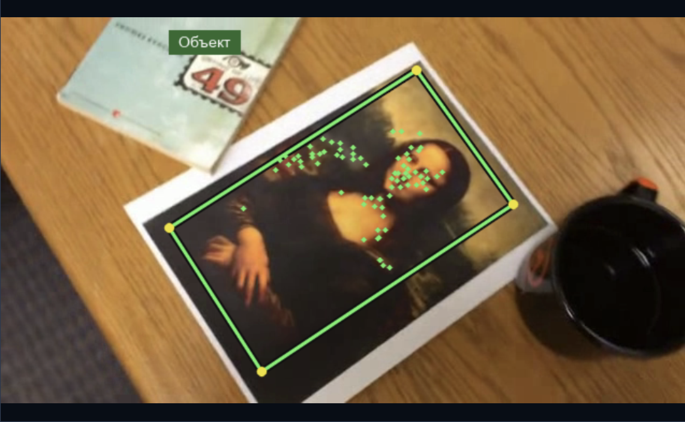

# Отчёт о разработке системы трекинга плоского объекта на видео

## 1. Теоретическая база

Трекинг по ключевым точкам - определение положения объекта в последовательности видеокадров посредством сопоставления характерных точек его изображения. Для надёжного сопровождения точки должны быть различимыми, устойчивыми к изменению ракурса и достаточно равномерно распределёнными по поверхности объекта.

В системе используются два взаимодополняющих метода:

LK (Lucas-Kanade) - межкадровое отслеживание точек. Первоначально углы выделяются методом Ши–Томаси, оценивающим качество точки по собственным значениям матрицы градиентов яркости:

$$
q=\min(\lambda_1,\lambda_2)
$$

где $\lambda_1,\lambda_2$ - собственные значения матрицы градиентов. Чем выше минимальное собственное значение, тем надёжнее определяется смещение точки.

Перемещение точек вычисляется пирамидальным методом Лукаса–Канаде, основанным на предположении о сохранении яркости:

$$
I(x,y,t)\approx I(x+u,y+v,t+1)
$$

После линеаризации получается уравнение оптического потока:

$$
I_xu+I_yv+I_t=0
$$

где $(u,v)$ - смещение точки, $I_x,I_y$ - пространственные производные яркости, $I_t$ - изменение яркости во времени. Смещение определяется минимизацией ошибки в локальном окне:

$$
E(u,v)=\sum_{(x,y)\in W}(I_xu+I_yv+I_t)^2
$$

Использование пирамиды изображений позволяет отслеживать более значительные межкадровые перемещения. LK эффективен при плавном движении, но может терять точки при перекрытии, размытии и резком смещении объекта.

SIFT (Scale-Invariant Feature Transform) - обнаружение ключевых точек и вычисление дескрипторов, устойчивых к изменениям масштаба и поворотам. Метод использует разности изображений, сглаженных гауссовым фильтром с разными масштабами:

$$
D(x,y,\sigma)=L(x,y,k\sigma)-L(x,y,\sigma)
$$

где $L(x,y,\sigma)$ - изображение, сглаженное гауссовым фильтром с параметром $\sigma$, $k$ - коэффициент изменения масштаба.

Каждая найденная точка описывается дескриптором, характеризующим распределение локальных градиентов яркости. Сопоставление с эталоном выполняется по расстояниям между дескрипторами. Неоднозначные совпадения исключаются с помощью Lowe ratio test:

$$
\frac{d_1}{d_2}<r
$$

где $d_1$ и $d_2$ - расстояния до первого и второго ближайших дескрипторов, $r$ - порог сопоставления.

Определение положения объекта. Для плоского объекта положение его границ определяется гомографией - перспективным преобразованием координат:

$$
\begin{bmatrix}x' \\ y' \\ 1\end{bmatrix}
\sim H\begin{bmatrix}x \\ y \\ 1\end{bmatrix}
$$

где $H$ - матрица размером $3\times3$, определяемая по соответствующим точкам исходного и текущего кадров.

Для исключения ошибочных соответствий используется RANSAC. Точка считается согласованной с моделью (инлайером), если ошибка её перепроецирования не превышает порог:

$$
e_i=|\mathbf{x}'_i-\pi(H\mathbf{x}_i)|<\varepsilon
$$

где $\pi$ - переход от однородных координат к обычным, $\varepsilon$ - допустимая ошибка в пикселях.

Применение рассчитанной гомографии к четырём исходным углам объекта позволяет строить рамку, учитывающую масштаб, поворот и перспективное искажение.

## 2. Описание разработанной системы

1. Пользователь загружает видео и выделяет объект прямоугольной областью на первом кадре. Выделенная область становится неизменным эталоном; для неё вычисляются точки Ши-Томаси и SIFT-дескрипторы.
2. При последовательном воспроизведении **LK** рассчитывает новые координаты точек. Проверка прямого и обратного переноса (*forward-backward check*) отбрасывает ненадёжные соответствия.
3. По согласованным точкам строится гомография методом **RANSAC**. Проверяются количество и распределение инлайеров, ошибка перепроекции и геометрическая корректность полученной рамки.
4. Если число точек становится недостаточным, **SIFT** ищет дополнительные соответствия в окрестности объекта и передаёт их LK. При потере объекта выполняется поиск по всему кадру. Пока достоверная гомография не найдена, рамка не отображается.
5. При произвольной перемотке трекинг не продолжается через пропущенные кадры: объект повторно локализуется по эталону с помощью SIFT.

**Архитектура приложения:**

| Модуль | Назначение |
|---|---|
| `app.py` | Интерфейс Tkinter: загрузка, разметка, воспроизведение, перемотка, настройки и экспорт. |
| `tracker.py` | Гибридный трекер LK/SIFT, проверка соответствий, оценка гомографии и восстановление объекта. |
| `render.py` | Отрисовка четырёхугольной рамки, названия объекта, ключевых точек и показателя FPS. |

**Возможности интерфейса:** навигация по кадрам, воспроизведение и пауза, переключение отображения ключевых точек и FPS обработки, настройка параметров LK, SIFT, Ши-Томаси и RANSAC, экспорт обработанного видео в MP4.

**Ограничения:** точность рамки зависит от исходной прямоугольной разметки; при сильном перспективном наклоне объекта уже на первом кадре она может включать фон. Малотекстурные, размытые, деформируемые и длительно перекрытые объекты отслеживаются менее надёжно.

## 3. Результаты работы

## 4. Выводы по работе

Разработана система сопровождения плоского объекта, сочетающая скорость межкадрового трекинга **LK** с возможностью повторного обнаружения по **SIFT**. Использование общей эталонной модели и гомографии позволяет строить перспективную рамку и восстанавливать сопровождение после потери ключевых точек. GUI объединяет разметку объекта, управление видео, настройку алгоритмов и экспорт результата. Применимость решения определяется наличием достаточной текстуры, близостью объекта к плоской модели и качеством исходной разметки.

## 5. Использованные источники

1. Lucas B. D., Kanade T. *An Iterative Image Registration Technique with an Application to Stereo Vision.* IJCAI, 1981. https://www.ijcai.org/Proceedings/81-2/Papers/018.pdf
2. Shi J., Tomasi C. *Good Features to Track.* CVPR, 1994. https://cecas.clemson.edu/~stb/LK/shi-tomasi-good-features-cvpr1994.pdf
3. Lowe D. G. *Distinctive Image Features from Scale-Invariant Keypoints.* International Journal of Computer Vision, 2004. https://www.cs.ubc.ca/~lowe/papers/ijcv04.pdf
4. OpenCV Documentation. *Optical Flow.* https://docs.opencv.org/4.x/d4/dee/tutorial_optical_flow.html
5. OpenCV Documentation. *Feature Matching + Homography to find Objects.* https://docs.opencv.org/4.x/d7/dff/tutorial_feature_homography.html